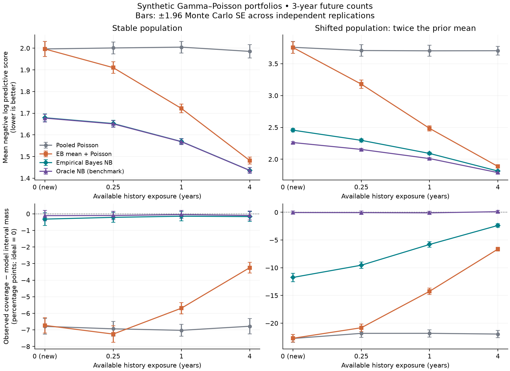
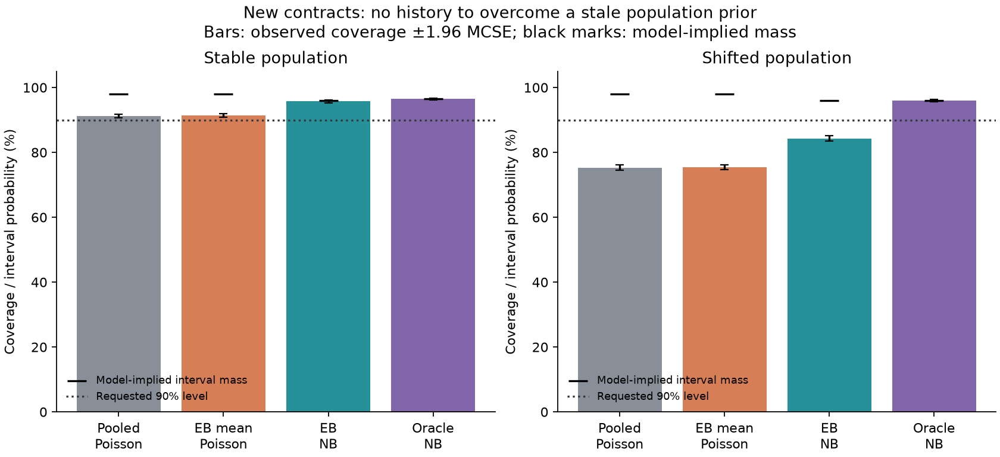

# Exposure-Aware Credibility Audit

An original actuarial/data-science portfolio project on **sparse count prediction
with unequal observation times**. It fits a Gamma–Poisson credibility model on
an independent calibration portfolio, then audits future-count predictions on
new contracts with varying amounts of history.

The central distinction is between predicting a mean and predicting a
distribution: a Poisson model plugged into the posterior mean has the same point
prediction as the negative-binomial predictive model, but omits uncertainty
about each contract's latent rate. A population-shift stress test shows why
accounting for that uncertainty does not fix a stale prior.

All data are **seeded synthetic portfolios**, generated locally from the explicit
model below. There are no policyholder records, private data, or performance
claims about real insurance portfolios. Educational use only; **not investment,
insurance pricing, underwriting, or other professional advice**.

## Reproduce

Python 3.11 or newer:

```bash
python3 -m venv .venv
source .venv/bin/activate
python -m pip install '.[test]'
python -m pytest -W error
credibility-audit --output artifacts
```

The default run uses 50 replications, each with 2,000 calibration contracts and
1,600 evaluation contracts in each of two scenarios. No network or external
dataset is needed. A smaller smoke run:

```bash
credibility-audit --replications 3 --calibration-size 1000 --evaluation-size 400 --output artifacts-check
```

`summary.json` contains stratum-level averages, replication-level Monte Carlo
standard errors, paired log-score differences, and optimizer diagnostics.
`replications.json` retains all fitted hyperparameters and replication metrics.
Two figures visualize predictive scoring, interval calibration, and cold starts.

For the committed run's Python 3.13 dependency versions, use
`python -m pip install -c constraints-py313.txt '.[test]'`. The standard install
and CI use supported version ranges. Repeated JSON is deterministic in the same
environment; cross-version numerical differences are possible.

## Results from the committed run

The default experiment evaluated **160,000 held-out contract futures** (50
replications × two scenarios × 1,600 contracts), each scored by four models.
The same calibration fit is reused across the two scenarios in each replication.
Values below average the four equally sized history-exposure strata.

| Model | Stable: negative log score | Stable: coverage | Shifted: negative log score | Shifted: coverage |
| --- | ---: | ---: | ---: | ---: |
| Pooled Poisson | 1.9969 | 91.14% | 3.7174 | 75.94% |
| EB mean + Poisson | 1.7776 | 91.71% | 2.8258 | 80.90% |
| Empirical Bayes NB | 1.5841 | 96.00% | 2.1645 | 88.62% |
| Oracle NB | 1.5830 | 96.17% | 2.0542 | 95.58% |

These are **predictive count intervals**, not confidence intervals for the mean
rate. Requested interval level is 90%; model-implied mass generally exceeds that
because counts are discrete. Full precision, interval widths, rate MSEs, and
MCSEs are in [summary.json](artifacts/summary.json).

- Holding point predictions fixed, EB NB improved mean negative log score over
  EB mean + Poisson by **0.19343** (paired MCSE **0.00373**) in the stable
  scenario. This comparison isolates the predictive-distribution choice.
- Stable-population EB NB intervals covered **96.00%**, versus model-implied
  mass **96.21%**. The difference was **-0.21 percentage points** (MCSE **0.10**),
  not evidence of an exact calibration guarantee. Hyperparameter uncertainty
  remains omitted.
- Shifted-population EB NB intervals covered **88.62%**, versus model-implied
  mass **95.98%**. For cold-start contracts alone, coverage fell to **84.30%**
  despite model-implied mass **96.04%**. Accounting for latent-rate uncertainty
  did not repair population mismatch.
- All 50 fits passed all three optimization starts. Mean fitted shape/rate were
  **0.8005 / 1.6281**, against generating values **0.8 / 1.6**; the maximum
  fitted mean-objective gradient was **6.58e-9**.



Panels use separate vertical scales; comparisons are numerical, not based on
relative visual slopes. The oracle is a simulation-only benchmark.



The **48-test** suite includes hand calculations, independent numerical
integration, analytic-gradient checks, exposure-unit conversion, zero-history
behavior, likelihood fitting, boundary failure, future-stream isolation, discrete
endpoint inclusion, deterministic reruns, paired MCSEs, and the complete CLI.
GitHub Actions runs the suite and a three-replication example on Python 3.11/3.13.

## Model and units

Counts are modeled per contract; exposures are in years. Gamma parameters use
the **shape/rate**, not shape/scale, convention:

```text
lambda_i ~ Gamma(alpha, beta)        E[lambda_i] = alpha/beta
K_i | lambda_i ~ Poisson(t_i lambda_i)
lambda_i | K_i,t_i ~ Gamma(A_i, B_i)
A_i = alpha + K_i; B_i = beta + t_i
Y_i | history ~ NB(n=A_i, p=B_i/(B_i+h))   [SciPy parameterization]
E[Y_i | history] = h A_i/B_i
Var[Y_i | history] = h A_i/B_i + h^2 A_i/B_i^2
```

The second variance term disappears under the plug-in Poisson model. For
positive history exposure, the posterior rate mean is
`Z_i (K_i/t_i) + (1-Z_i) (alpha/beta)`, where `Z_i=t_i/(beta+t_i)`.
A new contract has t=0 and K=0, so its posterior remains the population prior;
it is never assigned the invalid rate 0/0. Historical and future counts are
conditionally independent **given** the shared latent rate, not marginally
independent.

Hyperparameters maximize the exposure-aware marginal count log likelihood:

```text
log p(K | t, alpha,beta)
  = log Gamma(alpha+K) - log Gamma(alpha) - log(K!)
    + alpha log(beta/(beta+t)) + K log(t/(beta+t)).
```

Implementation details: analytic gradients in log parameters, three deterministic
L-BFGS-B starts, log-shape bounds [-6,8], log-rate bounds [-8,10]. A fit must be
interior, optimizer-successful, and have maximum absolute mean-objective gradient
below 1e-6. Bounds are numerical safeguards, not prior knowledge. All-zero
calibration counts and unsupported boundary/Poisson-limit optima fail explicitly;
no optimizer failure is silently replaced with oracle parameters.

## Evaluation design

1. Independently simulate a calibration population with Gamma(0.8,1.6) rates;
   history exposures are sampled from 0.25, 1, and 4 years. Fit the prior and
   pooled rate using only these counts and exposures.
2. Generate separate evaluation contracts with balanced history exposures
   0, 0.25, 1, and 4 years. Each contract has a three-year future-count target.
   Latent rates, history draws, and future draws use separate seeded streams.
3. Stable scenario: evaluation rates follow Gamma(0.8,1.6), mean 0.5/year.
   Shifted scenario: Gamma(0.8,0.8), mean 1/year. The whole evaluation contract,
   including its historical period, comes from this new population. This is
   **cross-population shift**, not an abrupt within-contract time-series change.
4. Score four models on the same held-out targets:

| Model | Uses individual history? | Predictive uncertainty |
| --- | --- | --- |
| Pooled Poisson | No | Poisson with calibration total count / total exposure |
| EB mean + Poisson | Yes | Poisson at the fitted posterior mean |
| Empirical Bayes NB | Yes | Integrates the contract rate under the fitted Gamma prior |
| Oracle NB | Yes | Uses the scenario's true hyperparameters; simulation benchmark only |

Neither evaluation histories nor future outcomes fit the population hyperparameters.
Individual histories update only individual posteriors. Oracle NB knows the
population parameters, **not** the true rate of each contract or any future count.

## Metrics and interpretation

- Mean negative log predictive score (natural-log units/count observation),
  lower is better; paired differences preserve the shared evaluation targets.
- Rate mean squared error against simulation-only latent truth, in squared
  counts/year units. EB mean + Poisson and EB NB share exactly this point estimate.
- Central predictive intervals `[ppf(0.05), ppf(0.95)]`, inclusive endpoints;
  width is upper minus lower, not the number of included integers.
- Discreteness usually makes model-implied interval mass exceed 90%. Therefore
  we report both observed coverage and the average probability each model assigns
  its own interval, plus their difference. A 95% observed coverage is not by itself
  proof of overconservatism relative to a requested 90% interval.
- Monte Carlo SE = SD of independent replication metrics / sqrt(replications).
  Error bars are ±1.96 MCSE, not individual predictive intervals or formal
  simultaneous confidence bands. Contracts share a fitted prior within a
  replication, so treating all rows as independent for Monte Carlo SE would be wrong.

## Limitations

This is empirical Bayes: latent-rate uncertainty is integrated, but fitted
hyperparameter uncertainty is **not**. It is not a full Bayesian analysis.
The oracle is correctly specified by construction. A synthetic advantage does
not establish real-world benefit. Exposure is known, independent of latent risk,
and constant-rate Poisson assumptions hold within each simulated contract.
There are no covariates, time trends, zero inflation, claim severity, dependence
between contracts, selection bias, censoring, or endogenous exposure.
No pricing decisions or real-world calibration guarantees are produced.

The standalone numerical fitter is deliberately small. Extreme counts/exposures,
nonidentified dispersion, and a population near the Poisson limit require more
care than the current bounded optimizer. Three starts do not prove a global optimum.

## References

- [Stan User's Guide: posterior predictive sampling](https://mc-stan.org/docs/stan-users-guide/posterior-prediction.html)
  explains posterior integration and the Gamma–Poisson/negative-binomial relation.
- [SciPy negative-binomial documentation](https://docs.scipy.org/doc/scipy/reference/generated/scipy.stats.nbinom.html)
  specifies the probability parameter convention used here.
- [Casualty Actuarial Society: Credibility](https://www.casact.org/sites/default/files/database/forum_87fforum_87ff079.pdf)
  discusses the classical Poisson–Gamma credibility model and predictive distributions.

The conjugate model is established mathematics. Code, tests, and this experiment
design are original; no novel-method claim or affiliation with the sources is made.
MIT licensed.
